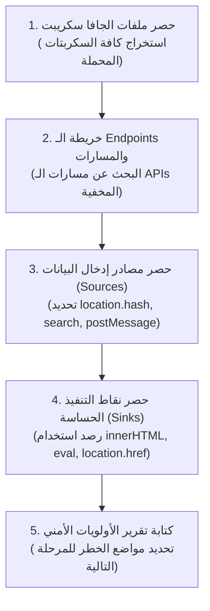

# المشروع العملي: JavaScript Recon & Code Review

> 🌐 **اللغة:** **العربية 🇸🇦** | [English Version (README.md)](./README.md)

---

## 🎯 1. فكرة وسيناريو المشروع

أنت مكلف كباحث أمني بإجراء استكشاف أولي وفحص كود الواجهة الأمامية (Client-Side Code Review) لتطبيق ويب تجريبي (`TargetShopApp`).  
هدفك في هذا المشروع ليس استغلال ثغرات معقدة بعد، بل **تفكيك سطح الهجوم**، ورسم خريطة دقيقة لكيفية تعامل التطبيق مع البيانات، وتحديد الـ Endpoints والمواضع الحساسة، وإخراج تقرير فحص احترافي.

---

## 📋 2. خطوات ومنهجية الفحص

---

## 📝 3. نموذج التقرير المطلوب تسليمه (`Recon_Report.md`)

يجب أن يحتوي تقريرك النهائي على الأقسام الأربعة التالية:

### القسم 1: جدول ملفات ومكتبات JavaScript
- حصر لجميع ملفات الـ JS مع تحديد مصدرها (داخلي First-party أو خارجي CDN) وإصدارات المكتبات المستخدمة لكشف المكتبات القديمة.

### القسم 2: دليل الـ Endpoints والمسارات المستخرجة
- قائمة بجميع مسارات الـ API والـ Routes المستخرجة من الكود (مثل: `/api/v1/user/orders` أو مسارات الإدارة `/admin/tools`).

### القسم 3: حصر مصادر بيانات المستخدم (Sources)
- قائمة بالأماكن التي يقرأ فيها كود جافا سكريبت مدخلات خارجية (`location.search`, `location.hash`, `window.name`, رسائل المتصفح).

### القسم 4: جدول أولويات الفحص الأمني (Triage Matrix)
- جدول يحدد المواضع المشبوهة التي تصل فيها المدخلات إلى نقاط تنفيذ حساسة (`innerHTML`, `eval`, `location.href`) مرتبة حسب درجة الاشتباه (High, Medium, Low) لتكون محور الاختبار العملي في المستوى الثاني.

---

## 🏆 معيار إنجاز المشروع
التقرير الناجح يُمكّن فريق الاختبار من فهم التطبيق كاملاً والبدء في استغلال الثغرات بدون إضاعة أي وقت في التخمين العشوائي.  
أنت الآن جاهز للانتقال إلى:  
👉 **[المستوى 2: Foundation Pentesting (اختبار الثغرات الشائعة وإثبات الأثر)](../../Level-2-Foundation-Pentesting/README.ar.md)**
