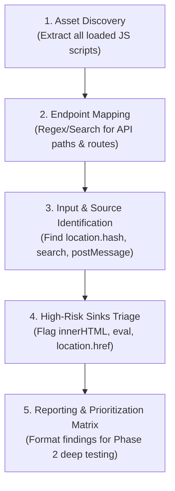

# Capstone Project: JavaScript Recon & Code Review

> 🌐 **Language:** **English** | [🇸🇦 النسخة العربية (README.ar.md)](./README.ar.md)

---

## 🎯 1. Project Overview & Scenario

You are assigned as a junior security auditor tasked with performing an initial client-side reconnaissance and source code audit on a target web application (`TargetShopApp`).  
Your objective is **not** to exploit complex bugs yet, but to dissect the JavaScript attack surface, trace untrusted data inputs, map hidden endpoints, and produce a professional scoping assessment report.

---

## 📋 2. Audit Workflow & Methodology

---

## 📝 3. Deliverable Report Template (`Recon_Report.md`)

Your final report must document the following sections:

### Section A: JavaScript Asset Inventory
- Table of loaded script URLs, origin (first-party vs CDN), and library versions (e.g. jQuery 3.5.1, Lodash 4.17.15).

### Section B: Extracted API & Route Directory
- List of all hardcoded REST/GraphQL routes extracted from scripts (e.g., `/api/v1/user/profile`, `/api/v1/admin/export`).

### Section C: User Input Sources Inventory
- Catalog of all client-side inputs observed reading from untrusted sources (`window.location.search`, `window.location.hash`, `window.addEventListener('message')`).

### Section D: High-Risk Code Sinks Matrix
- Identified code blocks where input reaches sensitive sinks (`innerHTML`, `eval`, `document.write`), categorized by risk priority (High, Medium, Low) for deep penetration testing in Level 2.

---

## 🏆 Project Completion Benchmark
A successful audit report clearly outlines the application's attack surface, enabling testing teams to proceed directly into flaw verification without blind testing. Proceed to:  
👉 **[Level 2 — Foundation Pentesting: Flaw Testing & Verification](../../Level-2-Foundation-Pentesting/README.md)**
