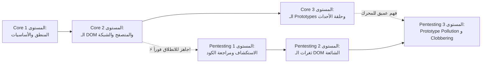
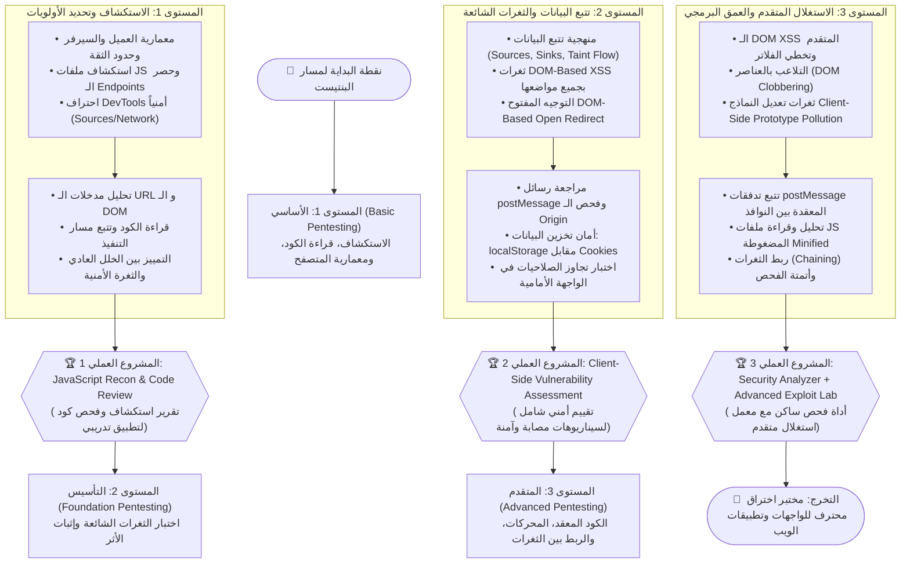

# 🛡️ مسار اختبار اختراق تطبيقات الويب بلغة جافا سكريبت | JavaScript for Web Pentesting

> 🌐 **اللغة:** **العربية 🇸🇦** | [English Version (README.md)](./README.md)

> **بِسْمِ اللَّهِ الرَّحْمَٰنِ الرَّحِيمِ**

مرحباً بك في مسار **JavaScript for Web Pentesting**!  
صُمم هذا المسار خصيصاً للباحثين الأمنيين ومختبري الاختراق (Pentesters) ومهندسي أمان التطبيقات (AppSec) الذين يرغبون في فهم أكواد الواجهة الأمامية، واكتشاف الثغرات العميقة، وتحليل المخاطر من جذورها البرمجية.

---

## 🎯 الفلسفة الجوهرية: فهم هندسي حقيقي بدلاً من حفظ الـ Payloads

> [!IMPORTANT]
> **الهدف الحقيقي لمختبر الاختراق المحترف:**  
> الفكرة ليست أن تتعلم أسماء الثغرات وتحفظ Payloads جاهزة للنسخ واللصق؛  
> بل الهدف الحقيقي هو أن تمتلك القدرة والمنهجية على:
> 1. **قراءة كود الموقع:** فهم المنطق البرمجي وكيف يتعامل مع المدخلات.
> 2. **اكتشاف نقطة ضعف محتملة:** استنتاج مسارات الخطر وتتبع تدفق البيانات.
> 3. **اختبارها بفرضية واضحة:** تجربة السيناريو في بيئة مصرح بها.
> 4. **إثبات تأثيرها الفعلي:** إثبات الأثر الأمني بدون افتراضات وهمية.
> 5. **فهم سببها الجذري وإصلاحها:** تقديم توصيات برمجية واضحة للمطورين.

---

## 🌉 متى تبدأ هذا المسار؟ (لست بحاجة لإنهاء كل شيء لتبدأ!)

**لا يشترط أبداً أن تنهي كل مفاهيم JavaScript المتقدمة في الـ Core حتى تدخل مسار الـ Pentesting:**

- **الحد الأدنى المطلوب:** بمجرد إنهائك **Level 2 (Foundation)** في مسار JavaScript Core وفهمك لشجرة الـ DOM، والأحداث، وكيف تتدفق البيانات، فأنت جاهز بنسبة 100% للبدء في **المستوى الأول والثاني في مسار الـ Pentesting** بالتوازي!
- يمكنك دراسة **Level 3 Core** (الـ Prototypes و الـ Event Loop) بالتزامن مع **Level 3 Pentesting** (الـ Prototype Pollution و DOM Clobbering).



---

## 🧭 المكاسب الخمسة التي ستخرج بها من هذا المسار

| # | المجال الأمني | ماذا ستتعلم؟ | المكسب العملي المباشر |
| :-: | :--- | :--- | :--- |
| **01** | **JavaScript Reconnaissance** | استكشاف ملفات JS، فهم وظائف الموقع، استخراج الـ API Endpoints، وتحديد المسارات التي تستحق الفحص. | بدلاً من الاختبار العشوائي أو الفحص الأعمى، تبني تصوراً هندسياً دقيقاً لطريقة عمل التطبيق الداخلي. |
| **02** | **Client-Side Code Review** | تفكيك الكود الذي يعمل في المتصفح، ومتابعة الدوال والأحداث والمتغيرات، وتحديد المواضع الخطرة. | تستنتج أماكن الخطر من الكود مباشرة بدلاً من الاعتماد على الـ Scanners الآلية وحدها. |
| **03** | **Vulnerability Discovery** | تتبع البيانات من مصدرها حتى مكان معالجتها وتنفيذها (**منهجية Sources إلى Sinks**). | تفهم ثغرات مثل DOM XSS و Open Redirect وتعرف بدقة إيه الشروط التي تجعل نمط الكود ثغرة فعلية. |
| **04** | **Browser & API Investigation** | ربط سلوك JavaScript بطلبات HTTP والـ APIs، والجمع بين متصفح الويب وأداة Burp Suite. | تنتقل بين تحليل الكود البرمجي وتحليل حركة بيانات الشبكة كعملية واحدة متكاملة. |
| **05** | **Verification & Reporting** | إثبات المشكلة في بيئة مصرح بها، وعزل النتائج الإيجابية الزائفة، وتوثيق الأدلة وكتابة تقرير إصلاحي. | تقدم نتائج مفهومة للمطورين وأصحاب العمل، مدعومة بالأدلة القاطعة وليس مجرد لقطة شاشة عابرة. |

---

## 🔁 الخطوات الخمس لاكتساب المهارة (The 5-Step Mindset)

كل موضوع وثغرة في هذا المسار ندرسه عبر هذا الإطار التفكيري المتكرر:

```
  [ 1. افهم ]  ➔  [ 2. استكشف ]  ➔  [ 3. اختبر ]  ➔  [ 4. أثبت ]  ➔  [ 5. وثق وأصلح ]
  الآلية والحدود    البحث وأدوات         فرضية واحدة       تتبع التدفق        السبب الجذري
  وكود الثغرة       DevTools            في لاب مصرح        والأثر الفعلي        وكتابة التقرير
```

1. **Understand (افهم):** ابدأ بآلية عمل التقنية، وحدود الثقة بين العميل والسيرفر، وسبب ظهور الثغرة، مع مقارنة الكود الآمن بالكود المصاب.
2. **Investigate (استكشف):** استخدم البحث داخل الملفات وأدوات المتصفح (DevTools) لتحديد المدخلات والدوال والمواضع الحساسة.
3. **Test (اختبر):** استخدم لاباً مصرحاً به، واختبر فرضية واحدة في كل مرة وراقب النتيجة الفعلية بدون افتراضات.
4. **Verify (أثبت):** تحقق من مسار البيانات والشروط وتأثير الثغرة، وميّز بين النمط المريب (Code Smell) والثغرة المؤكدة.
5. **Document & Fix (وثق وأصلح):** اكتب خطوات إعادة الاختبار، والأدلة، والسبب الجذري، والتأثير، وطريقة الإصلاح البرمجي، وتأكد من نجاح الإصلاح.

---

## 🗺️ خارطة مستويات مسار اختبار الاختراق (من السهل للصعب للأصعب)



---

## 📂 هيكلية مجلدات مسار الـ Pentesting

```plaintext
JavaScript-Web-Pentesting/
├── README.md                                    # Master Track Overview & Roadmap (English)
├── README.ar.md                                 # هذا الملف (الدليل العربي الشامل)
│
├── Level-1-Basic-Pentesting/                    # 🟢 المستوى 1: الاستكشاف وقراءة الكود
│   ├── README.md (English)
│   ├── README.ar.md (العربية)
│   ├── Lessons/ (en/ & ar/)                     # المعمارية، الاستكشاف، DevTools، وتتبع المدخلات
│   └── Practical-Project/ (en/ & ar/)           # مشروع: تقرير فحص واستكشاف JS
│
├── Level-2-Foundation-Pentesting/               # 🟡 المستوى 2: الثغرات الشائعة وإثبات الأثر
│   ├── README.md (English)
│   ├── README.ar.md (العربية)
│   ├── Lessons/ (en/ & ar/)                     # Taint Flow, DOM XSS, Open Redirect, postMessage
│   └── Practical-Project/ (en/ & ar/)           # مشروع: تقييم أمني عملي للتطبيق
│
└── Level-3-Advanced-Pentesting/                 # 🔴 المستوى 3: الكود المعقد والربط بين الثغرات
    ├── README.md (English)
    ├── README.ar.md (العربية)
    ├── Lessons/ (en/ & ar/)                     # DOM Clobbering, Prototype Pollution, Minification
    └── Practical-Project/ (en/ & ar/)           # مشروع: أداة فحص ساكن مع معمل متقدم
```

---

## 🚀 كيف تبدأ الآن؟

1. **الخطوة الأولى:** اقرأ نظرة عامة على [`المستوى الأول: Basic Pentesting`](./Level-1-Basic-Pentesting/README.ar.md).
2. **الخطوة الثانية:** ادرس دروس الاستكشاف (Reconnaissance) واحتراف أدوات الـ DevTools.
3. **الخطوة الثالثة:** طبق المعمل العملي للمستوى الأول وأخرج أول تقرير أمني احترافي!

---

<p align="center">
  صُمم بـ ❤️ لمختبري الاختراق وباحثي الأمن السيبراني • متوفر باللغتين العربية والإنجليزية
</p>
