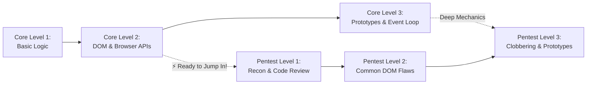
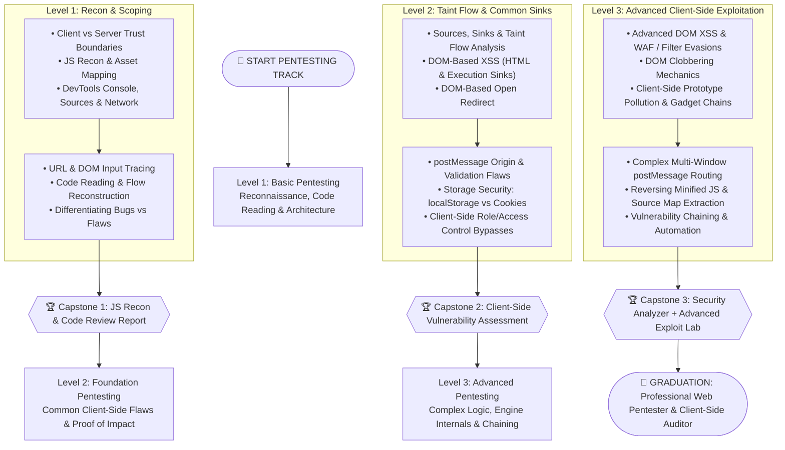

# 🛡️ JavaScript for Web Pentesting | مسار اختبار اختراق تطبيقات الويب

> 🌐 **Language:** **English** | [🇸🇦 تصفح باللغة العربية (README.ar.md)](./README.ar.md)

Welcome to the **JavaScript for Web Pentesting** track!  
This track is designed specifically for security researchers, penetration testers, and application security engineers who want to analyze client-side code, uncover hidden flaws, and understand root vulnerabilities from first principles.

---

## 🎯 The Core Philosophy: Real Engineering vs. Payload Memorization

> [!IMPORTANT]
> **The Real Objective of a Modern Web Pentester:**  
> The goal is **NOT** to memorize vulnerability names or copy-paste public payloads.  
> The true objective is developing the analytical capability to:
> 1. Read and dissect production application source code.
> 2. Discover potential architectural and logic weaknesses.
> 3. Formulate testing hypotheses and verify them in authorized environments.
> 4. Prove tangible business and security impact without false positives.
> 5. Pinpoint root causes and provide actionable, robust remediation guidance.

---

## 🌉 The Transition Bridge: When Should You Enter This Track?

**You do NOT need to master every advanced JavaScript concept before starting pentesting.**

- **The Minimum Requirement:** Once you complete **Level 2 (Foundation)** in JavaScript Core (understanding the DOM tree, events, and data flow), you are 100% equipped to start **Level 1 and Level 2 Pentesting** in parallel!
- You can study **Level 3 Core** (Prototypes, Event Loop internals) alongside **Level 3 Pentesting** (Prototype Pollution, DOM Clobbering).



---

## 🧭 The 5 Core Capabilities You Will Acquire

| # | Pillar Domain | What You Will Learn | Your Practical Return (The Gain) |
| :-: | :--- | :--- | :--- |
| **01** | **JavaScript Reconnaissance** | Map application JavaScript assets, identify state handling, extract hidden API endpoints, and pinpoint high-value inspection targets. | Instead of testing randomly or blind fuzzing, you build an accurate architectural mental model of how the application operates. |
| **02** | **Client-Side Code Review** | Dissect browser-executed JavaScript, trace functions, event handlers, and scoped variables to identify hazardous implementation patterns. | You identify attack surfaces directly from source code logic rather than relying solely on black-box automated scanners. |
| **03** | **Vulnerability Discovery** | Systematically trace untrusted input from its origin to where it gets processed (**Source-to-Sink Taint Flow Analysis**). | You master real vulnerabilities like DOM XSS and Open Redirects, understanding the exact conditions required for a pattern to become exploitable. |
| **04** | **Browser & API Investigation** | Correlate JavaScript runtime state with HTTP traffic and REST APIs using browser DevTools and Burp Suite in tandem. | You bridge the gap between code analysis and network telemetry, treating client-server communication as a unified system. |
| **05** | **Verification & Reporting** | Replicate flaws inside authorized labs, verify constraints, isolate false positives, document forensic evidence, and write actionable remediation. | You deliver high-value technical audit reports that developers can understand and remediate immediately. |

---

## 🔁 The 5-Step Engineering Mindset (The Repeatable Framework)

Every security topic in this track follows a rigorous 5-step engineering methodology:

```
  [ 1. Understand ]  ➔  [ 2. Investigate ]  ➔  [ 3. Test ]  ➔  [ 4. Verify ]  ➔  [ 5. Document & Fix ]
   Theory & Trust        Code Search &         Hypothesis       Taint Flow &        Root Cause &
     Boundaries             DevTools           Validation      Impact Proof         Remediation
```

1. **Understand (افهم):** Dissect the underlying browser technology, trust assumptions, and why the vulnerability occurs. Differentiate safe patterns from hazardous ones.
2. **Investigate (استكشف):** Leverage search, DevTools, and AST grep to identify entry inputs, sensitive functions, and execution sinks.
3. **Test (اختبر):** Inside an authorized lab, test one isolated hypothesis at a time. Observe runtime behavior rather than assuming success.
4. **Verify (أثبت):** Confirm the full end-to-end data flow, execution constraints, and measurable impact. Distinguish suspicious patterns from confirmed vulnerabilities.
5. **Document & Fix (وثق وأصلح):** Formulate clear reproduction steps, proof-of-concept evidence, root cause rationale, and validated remediation.

---

## 🗺️ Pentesting Progression Roadmap (From Easy to Advanced)



---

## 📂 Track Structure & Directory Layout

```plaintext
JavaScript-Web-Pentesting/
├── README.md                                    # Master Track Overview & Roadmap (English)
├── README.ar.md                                 # الدليل وخريطة المسار بالعربية
│
├── Level-1-Basic-Pentesting/                    # 🟢 LEVEL 1: Recon & Scoping
│   ├── README.md                                # Level 1 Guide & Checklist
│   ├── README.ar.md                             # دليل المستوى الأول بالعربية
│   ├── Lessons/ (en/ & ar/)                     # Architecture, Recon, DevTools, Input Tracing
│   └── Practical-Project/ (en/ & ar/)           # Project: JS Recon & Code Review Report
│
├── Level-2-Foundation-Pentesting/               # 🟡 LEVEL 2: Flaw Identification & Verification
│   ├── README.md                                # Level 2 Guide & Checklist
│   ├── README.ar.md                             # دليل المستوى الثاني بالعربية
│   ├── Lessons/ (en/ & ar/)                     # Taint Flow, DOM XSS, Redirect, postMessage, Storage
│   └── Practical-Project/ (en/ & ar/)           # Project: Client-Side Vulnerability Assessment
│
└── Level-3-Advanced-Pentesting/                 # 🔴 LEVEL 3: Complex Internals & Chaining
    ├── README.md                                # Level 3 Guide & Checklist
    ├── README.ar.md                             # دليل المستوى الثالث بالعربية
    ├── Lessons/ (en/ & ar/)                     # Clobbering, Prototype Pollution, Minified JS, Chaining
    └── Practical-Project/ (en/ & ar/)           # Project: Security Analyzer + Advanced Lab
```

---

## 🚀 How to Begin Your Pentesting Journey

1. **Step 1:** Review [`Level 1 — Basic Pentesting Overview`](./Level-1-Basic-Pentesting/README.md).
2. **Step 2:** Study the foundational lessons on JavaScript Reconnaissance and DevTools forensics.
3. **Step 3:** Perform the practical hands-on labs and deliver the **Recon & Code Review** capstone report.

---

<p align="center">
  Forged for ethical penetration testers and security engineers worldwide • Bilingual English / العربية
</p>
