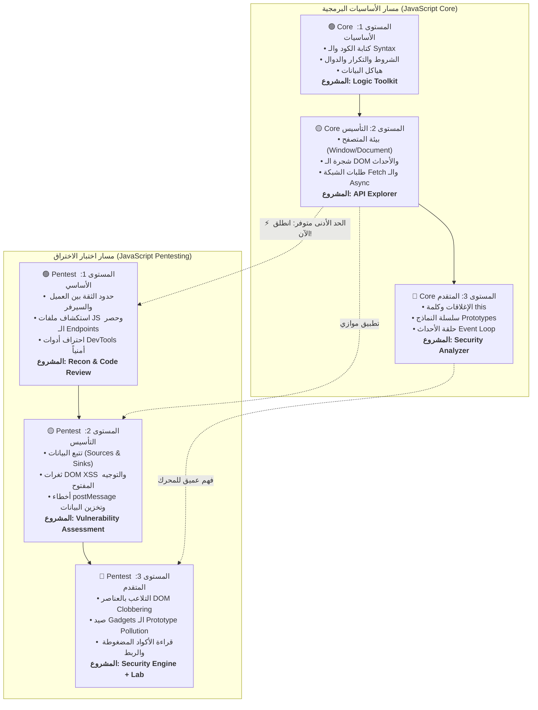

# ⚡ 01 - مسار جافا سكريبت الأساسي وهندسة الأمان | JavaScript Core & Pentesting

> 🌐 **اللغة:** **العربية 🇸🇦** | [English Version (README.md)](./README.md)

> **بِسْمِ اللَّهِ الرَّحْمَٰنِ الرَّحِيمِ**

مرحباً بك في **مسار جافا سكريبت الأساسي وهندسة أمان الويب**!  
هذا الدليل الشامل مصمم ليجمع بين الفهم العميق للغة جافا سكريبت وسلوكها داخل المتصفح، وبين اختبار الاختراق والتحليل الأمني العملي للواجهات الأمامية.

---

## 🧭 خريطة المسار المزدوجة (Roadmap)

**لست بحاجة لإنهاء كل مفاهيم جافا سكريبت المتقدمة لتبدأ اختبار الاختراق:**  
بمجرد إنهائك **Level 2 (Foundation)** في مسار الـ Core (فهم الـ DOM والأحداث والشبكة)، يمكنك البدء فوراً في **المستوى الأول والثاني في مسار الـ Pentesting** بالتوازي!

---

## 📚 أقسام ومستويات المسار

### 🧠 القسم الأول: مسار لغة جافا سكريبت الصافية (Core Track)
1. **[المستوى 1 — الأساسيات والمنطق البرمجي](./Level-1-Basic/README.ar.md)**  
   إتقان الـ Syntax، والأنواع، والشروط، والتكرار، والدوال، والتفكير المنطقي.  
   *(المشروع الختامي: JavaScript Logic Toolkit)*
2. **[المستوى 2 — التأسيس والمتصفح والـ DOM](./Level-2-Foundation/README.ar.md)**  
   إتقان بيئة المتصفح، والتحكم بالـ DOM، ونظام الأحداث، والاتصال بالـ APIs.  
   *(المشروع الختامي: API Explorer)*
3. **[المستوى 3 — العمق الداخلي للمحرك](./Level-3-Advanced/README.ar.md)**  
   فهم آليات محرك V8: الإغلاقات المعجمية، الوراثة عبر النماذج، وحلقة الأحداث.  
   *(المشروع الختامي: JavaScript Security Analyzer)*

---

### 🛡️ القسم الثاني: مسار اختبار اختراق تطبيقات الويب (Pentesting Track)
👉 **[الدخول لمسار JavaScript for Web Pentesting الكامل](./JavaScript-Web-Pentesting/README.ar.md)**

1. **[المستوى 1 — الأساسي: الاستكشاف وقراءة الكود](./JavaScript-Web-Pentesting/Level-1-Basic-Pentesting/README.ar.md)**  
   تعلم استكشاف أسطح الهجوم، حصر الـ Endpoints المخفية، واستخدام DevTools للتحقيق الأمني.  
   *(المشروع الختامي: تقرير الاستكشاف وفحص الكود)*
2. **[المستوى 2 — التأسيس: اختبار الثغرات وإثبات الأثر](./JavaScript-Web-Pentesting/Level-2-Foundation-Pentesting/README.ar.md)**  
   إتقان منهجية تتبع البيانات الملوثة (Sources $\to$ Sinks). إثبات ثغرات DOM XSS، والتوجيه المفتوح، وأخطاء postMessage.  
   *(المشروع الختامي: تقييم أمني شامل لسيناريوهات مصابة وآمنة)*
3. **[المستوى 3 — المتقدم: الكود المعقد والربط بين الثغرات](./JavaScript-Web-Pentesting/Level-3-Advanced-Pentesting/README.ar.md)**  
   تشريح الثغرات العميقة: DOM Clobbering، وصيد Gadgets الـ Prototype Pollution، وقراءة الأكواد المضغوطة Minified، والربط بين الثغرات المتفرقة.  
   *(المشروع الختامي: أداة فحص ساكن مع معمل استغلال متقدم)*

---

## 🎯 معايير التخرج
- **إنهاء الـ Core:** فهم كيف يفكر محرك المتصفح وكيف تُنفذ وتُدار العمليات غير المتزامنة.
- **إنهاء الـ Pentesting:** لست حافظاً لأسماء وثغرات جاهزة، بل باحثاً قادراً على قراءة سورس كود الموقع، وتتبع مسار البيانات، وإثبات الأثر الأمني الفعلي، وكتابة تقرير إصلاح هندسي سليم.

---

## 🚀 خطوتك التالية المقترحة:
- إذا كنت مبتدئاً في جافا سكريبت: 👉 **[ابدأ من Core المستوى الأول](./Level-1-Basic/README.ar.md)**
- إذا كنت تفهم الـ DOM والـ Functions بالفعل: 👉 **[ادخل مباشرة إلى Pentesting المستوى الأول](./JavaScript-Web-Pentesting/Level-1-Basic-Pentesting/README.ar.md)**
