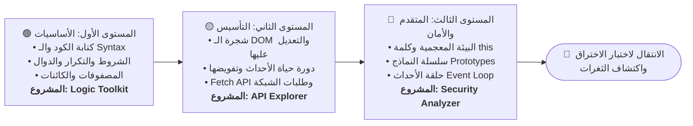

# ⚡ 01 - مسار جافا سكريبت الأساسي | JavaScript Core Track

> 🌐 **اللغة:** **العربية 🇸🇦** | [English Version (README.md)](./README.md)

> **بِسْمِ اللَّهِ الرَّحْمَٰنِ الرَّحِيمِ**

مرحباً بك في **مسار JavaScript Core الأساسي**! هذا المسار مخصص للمطورين ومهندسي البرمجيات والمهتمين بالأمن السيبراني الذين يسعون لفهم حقيقي، عميق، وواضح للغة جافا سكريبت، وسلوكها الداخلي، وتفاعلها مع المتصفح والـ DOM والخوادم.

---

## 🧭 خريطة مسار جافا سكريبت الأساسي (Roadmap)

تتبع الخريطة التالية للانتقال المنظم من الأساسيات حتى تحليل الأكواد وفحصها أمنياً:

---

## 💡 نقطة جوهرية: فصل الأساسيات (Core) عن اختبار الاختراق (Web Pentesting)

> [!IMPORTANT]
> **لماذا نفصل بين دراسة اللغة الصافية واختبار الاختراق؟**  
> - **JavaScript Core (هذا المسار):** تتعلم فيه كيف تفكر اللغة، وكيف تدار الذاكرة في الـ Stack والـ Heap، وكيف يفهم المتصفح عناصر الـ DOM، وكيف تُنظم العمليات غير المتزامنة في الـ Event Loop.
> - **JavaScript for Web Pentesting (المسار التخصصي التالي):** تطبيق هذه المعرفة العميقة لاكتشاف وتحليل واستغلال ثغرات المتصفح مثل: **DOM-based XSS**, **DOM Open Redirect**, **postMessage Misconfigurations**, و **Prototype Pollution**.  
> *الفهم الصلب للمستوى الثاني (تدفق البيانات في الـ DOM) والمستوى الثالث (آليات الـ Prototypes) هو الأساس الحتمي لأي باحث أمني محترف!*

---

## 🗺️ جدول المستويات والمشاريع

| المستوى | الهدف التعليمي | المشروع الختامي | روابط مباشرة |
| :--- | :--- | :--- | :---: |
| **المستوى 1 — الأساسي** | قراءة وفهم وكتابة كود منطقي بدون نسخ ولصق. إتقان الأنواع، الشروط، التكرار، والدوال. | **JavaScript Logic Toolkit** | [دليل المستوى](./Level-1-Basic/README.ar.md) [الدروس](./Level-1-Basic/Lessons/ar/01-introduction.md) |
| **المستوى 2 — التأسيس** | فهم تفاعل جافا سكريبت مع المتصفح الحي. تعديل الـ DOM بأمان، إدارة الأحداث، والاتصال بالـ APIs. | **API Explorer** | [دليل المستوى](./Level-2-Foundation/README.ar.md) [المعامل التطبيقية](./Level-2-Foundation/Practical-Applications/ar/README.md) |
| **المستوى 3 — المتقدم** | كشف أسرار محرك التشغيل: مكدس الاستدعاء، طوابير الـ Microtasks، الـ Prototype Chain، وفحص الأكواد أمنياً. | **JavaScript Security Analyzer** | [دليل المستوى](./Level-3-Advanced/README.ar.md) [معامل المراجعة](./Level-3-Advanced/Testing-and-Review/ar/README.md) |

---

## 🎯 معايير اجتياز كل مستوى (كيف تتأكد أنك أتقنته بالفعل؟)

1. **إتقان Level 1:** تستطيع حل المسائل البرمجية الخمسة بدون نسخ الكود، وتشرح الفروق بين أنواع المتغيرات، وتصلح أخطاء الـ Syntax والـ ReferenceError بسهولة.
2. **إتقان Level 2:** تستطيع بناء صفحة تفاعلية، وربط أحداث المستخدم، وتتبع بيانات الـ URL أو الـ Form حتى وصولها لطلب الـ API، واستخدام Breakpoints في DevTools.
3. **إتقان Level 3:** تستطيع تتبع الترتيب الدقيق للـ Promises والـ Callbacks، وفهم تسلسل الوراثة عبر الـ Prototypes، وتحديد الأنماط البرمجية الخطرة (Dangerous Sinks).

---

## 🚀 خطوتك الأولى المقترحة
ابدأ الآن مباشرة من:  
👉 **[الدرس الأول: مقدمة عن جافا سكريبت وبيئة العمل](./Level-1-Basic/Lessons/ar/01-introduction.md)**
