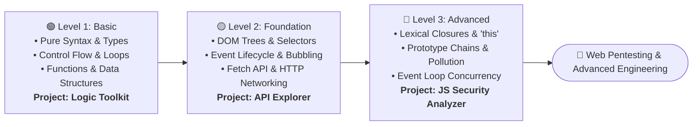

# ⚡ 01 - JavaScript Core Track

> 🌐 **Language:** **English** | [🇸🇦 النسخة العربية (README.ar.md)](./README.ar.md)

Welcome to the **JavaScript Core Track**! This track is designed for software engineers, web developers, and security practitioners who seek a deep, unambiguous understanding of the JavaScript language, its runtime environments, execution contexts, and browser interactions.

---

## 🧭 The JavaScript Core Journey (Roadmap)

Follow the structured roadmap below to advance from raw syntax to advanced code audits:

---

## 💡 Foundational Architecture: Core vs. Web Pentesting

> [!IMPORTANT]
> **Why We Decouple JavaScript Core from Web Security Testing:**  
> - **JavaScript Core (This Track):** Teaches how the language functions natively, how memory is allocated on the stack and heap, how the browser DOM interprets nodes, and how asynchronous events are queued in the Event Loop.
> - **JavaScript for Web Pentesting (Subsequent Specialized Track):** Applies this fundamental knowledge toward auditing, identifying, and exploiting browser-side vulnerabilities: **DOM-based XSS**, **DOM Open Redirects**, **Insecure `postMessage` handlers**, and **Prototype Pollution**.  
> *A solid mastery of Core (especially Level 2 DOM flows and Level 3 prototype chains) is the non-negotiable prerequisite to mastering client-side application security!*

---

## 🗺️ Progression Matrix

| Level | Pedagogical Goal | Deliverable Capstone | Direct Links |
| :--- | :--- | :--- | :---: |
| **Level 1 — Basic** | Read, reason through, and write pure JavaScript logic without relying on copy-pasting. Master types, control structures, and functional routines. | **JavaScript Logic Toolkit** | [Overview](./Level-1-Basic/README.md) [Lessons](./Level-1-Basic/Lessons/en/01-introduction.md) |
| **Level 2 — Foundation** | Understand how JavaScript drives the interactive web. Manipulate the DOM securely, handle event propagation, dispatch HTTP calls, and trace state in DevTools. | **API Explorer** | [Overview](./Level-2-Foundation/README.md) [Applied Labs](./Level-2-Foundation/Practical-Applications/en/README.md) |
| **Level 3 — Advanced** | Demystify internal runtime mechanics: the call stack, microtask queues, closure memory retention, prototype chains, and static code security auditing. | **JavaScript Security Analyzer** | [Overview](./Level-3-Advanced/README.md) [Code Audits](./Level-3-Advanced/Testing-and-Review/en/README.md) |

---

## 🎯 Verification Criteria (How Do You Know You Have Finished Each Level?)

1. **Level 1 Completion:** You can solve scalar algorithmic problems without copying solutions, explain variable scoping boundaries, and comfortably debug simple runtime exceptions.
2. **Level 2 Completion:** You can construct a dynamic client-side interface, bind robust event listeners, dispatch asynchronous API requests, and trace variables via DevTools Breakpoints.
3. **Level 3 Completion:** You can dissect complex asynchronous execution order, trace prototype property lookups, profile data flows for dangerous injection sinks, and write defensive unit tests.

---

## 🚀 Recommended Next Step
Start immediately at:  
👉 **[Level 1 — Lesson 01: Introduction & Runtime Environment](./Level-1-Basic/Lessons/en/01-introduction.md)**
