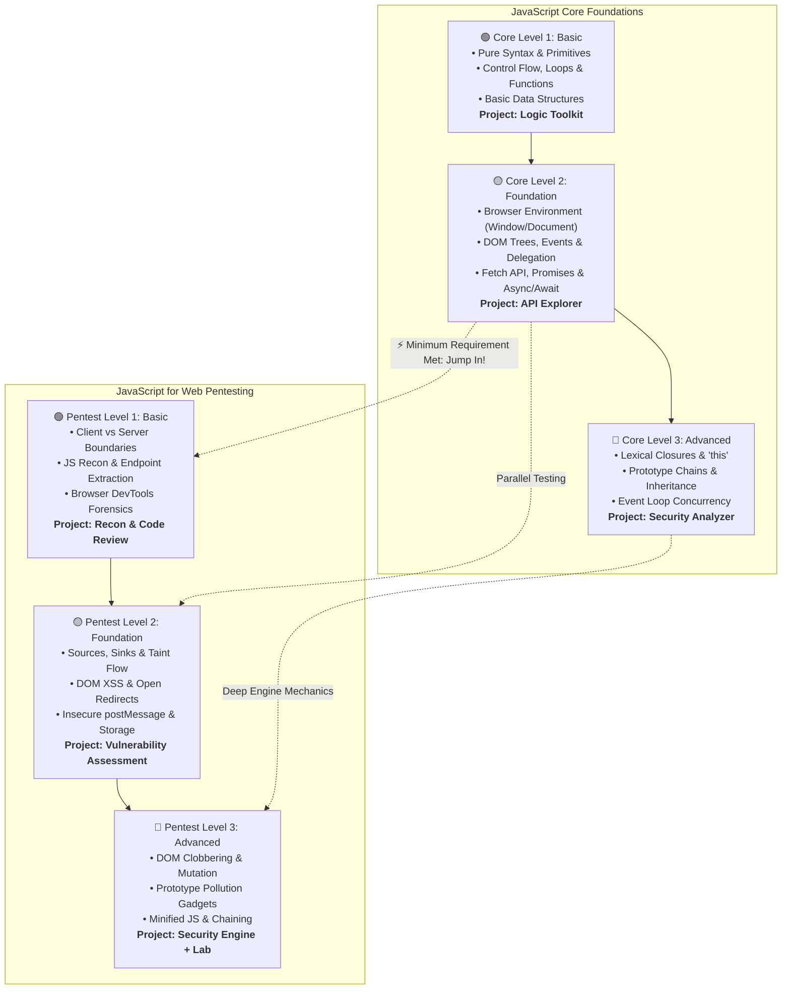

# ⚡ 01 - JavaScript Core & Security Engineering Track

> 🌐 **Language:** **English** | [🇸🇦 النسخة العربية (README.ar.md)](./README.ar.md)

Welcome to the **JavaScript Core & Security Engineering Track**! This comprehensive guide is designed for developers and security engineers seeking a deep, unambiguous understanding of the JavaScript language, its browser execution mechanics, and modern client-side application security testing.

---

## 🧭 Master Architectural Roadmap

You do **NOT** need to finish all advanced core concepts before exploring pentesting.  
Once you complete **Level 2 (Foundation)** in Core (understanding the DOM tree and data flow), you can immediately begin **Level 1 & Level 2 Pentesting** in parallel!

---

## 📚 Tracks & Levels Directory

### 🧠 Phase A: JavaScript Core Track
1. **[Level 1 — Basic: JavaScript Logic & Syntax](./Level-1-Basic/README.md)**  
   Master language grammar, types, control flow, functions, and pure computational logic.  
   *(Capstone: JavaScript Logic Toolkit)*
2. **[Level 2 — Foundation: The Browser Environment & Web APIs](./Level-2-Foundation/README.md)**  
   Master browser runtime mechanics, DOM manipulation, event lifecycles, and asynchronous networking.  
   *(Capstone: API Explorer)*
3. **[Level 3 — Advanced: Deep Runtime Mechanics](./Level-3-Advanced/README.md)**  
   Demystify V8 internal mechanics: lexical closures, the `this` model, prototype chains, and the Event Loop.  
   *(Capstone: JavaScript Security Analyzer)*

---

### 🛡️ Phase B: Client-Side Security & Web Pentesting
👉 **[Enter the JavaScript for Web Pentesting Master Track](./JavaScript-Web-Pentesting/README.md)**

1. **[Pentest Level 1 — Basic: Reconnaissance & Code Reading](./JavaScript-Web-Pentesting/Level-1-Basic-Pentesting/README.md)**  
   Learn to map application attack surfaces, extract hidden endpoints, and use DevTools for forensic inspection.  
   *(Capstone: JS Recon & Code Review Report)*
2. **[Pentest Level 2 — Foundation: Flaw Testing & Verification](./JavaScript-Web-Pentesting/Level-2-Foundation-Pentesting/README.md)**  
   Master Source-to-Sink Taint Flow analysis. Isolate real DOM XSS, DOM Open Redirects, and postMessage flaws from benign code smells.  
   *(Capstone: Client-Side Vulnerability Assessment)*
3. **[Pentest Level 3 — Advanced: Complex Internals & Chaining](./JavaScript-Web-Pentesting/Level-3-Advanced-Pentesting/README.md)**  
   Dissect advanced client-side vulnerabilities: DOM Clobbering, Prototype Pollution gadget hunting, minified JS reversing, and vulnerability chaining.  
   *(Capstone: Security Analyzer + Advanced Exploit Lab)*

---

## 🎯 Verification Criteria (How Do You Know You Have Finished Each Phase?)

- **Core Finished:** You understand how JavaScript executes, can manipulate the DOM, and can trace asynchronous event timing.
- **Pentesting Finished:** You do not just memorize payloads; you read client-side code, trace taint flows, prove tangible security impact in authorized labs, and author patch-ready remediation.

---

## 🚀 Recommended Next Step
- If you are new to JS: 👉 **[Start with Core Level 1](./Level-1-Basic/README.md)**
- If you already know basic DOM & functions: 👉 **[Jump into Pentest Level 1](./JavaScript-Web-Pentesting/Level-1-Basic-Pentesting/README.md)**
