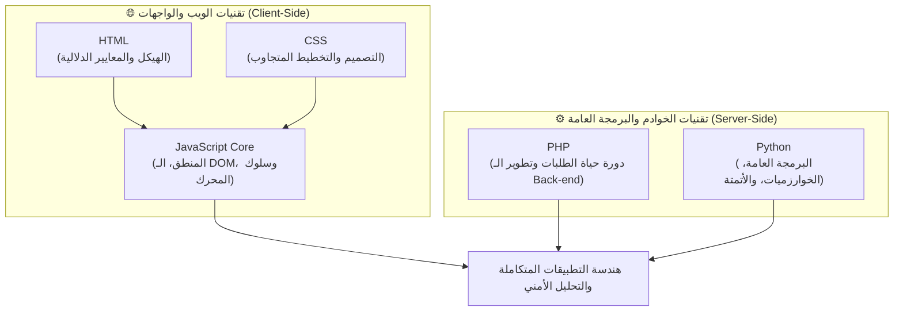

# 🚀 دليل لغات البرمجة وتطوير البرمجيات | Programming Languages Guide

> 🌐 **اللغة:** **العربية 🇸🇦** | [English Version (README.md)](./README.md)

> **بِسْمِ اللَّهِ الرَّحْمَٰنِ الرَّحِيمِ**
>
> *"وَقُل رَّبِّ زِدْنِي عِلْمًا"*

مرحباً بك في **دليل لغات البرمجة وهندسة الويب**!  
هذا المستودع صُمم ليكون مرجعاً تعليمياً وهندسياً مفتوح المصدر وثنائي اللغة، يقدم مسارات تعليمية منظمة وعميقة لأهم لغات البرمجة وتقنيات الويب وبيئات التشغيل المختلفة.

---

## 🗺️ خريطة المسارات الشاملة (Curriculum Roadmap)

تُمثل التقنيات في هذا المستودع الركائز الأساسية التي يعتمد عليها بناء وتطوير البرمجيات الحديثة، مقسمة بين تقنيات الويب والواجهات وتقنيات الخوادم والبرمجة العامة:

---

## 📚 أقسام ومسارات المستودع

يتم تقسيم كل لغة إلى وحدات تعليمية متدرجة، مدعومة بأمثلة كود عملية، وتمارين لاختبار الفهم، ومشاريع ختامية لاختبار المنطق البرمجي.

### 🌐 1. تقنيات الويب وبيئات تشغيل المتصفح

* **[مسار جافا سكريبت الأساسي (`/01-JavaScript-Core`)](./01-JavaScript-Core/README.ar.md)**  
  مسار هندسي متكامل ومفصل على 3 مستويات: ينقلك من كتابة كود الـ Syntax الصافي، مروراً بالـ DOM والـ Web APIs والبرمجة غير المتزامنة، وحتى احتراف السلوك الداخلي لمحرك V8 (الـ Event Loop، وسلسلة الـ Prototypes، والإغلاقات)، وصولاً للتحليل الأمني للأكواد الساكنة.
  - 👉 **[تصفح مسار جافا سكريبت الكامل](./01-JavaScript-Core/README.ar.md)**

* **HTML**  
  هيكلة صفحات الويب، العناصر الدلالية (Semantic HTML)، شجرة عناصر الـ DOM، والنماذج (Forms)، ومعايير إتاحة الويب لجميع المستخدمين (a11y).

* **CSS**  
  محركات التخطيط الحديثة (Flexbox و CSS Grid)، التصميم المتجاوب مع مختلف الشاشات، المتغيرات، وتحسين أداء الرسم والتنسيق في المتصفح.

---

### ⚙️ 2. تقنيات الخوادم والبرمجة العامة

* **PHP**  
  البرمجة من جانب الخادم (Server-side)، دورة حياة طلبات واستجابات HTTP، إدارة الجلسات (Sessions)، التعامل مع قواعد البيانات، وهيكلة الـ APIs.

* **Python**  
  هياكل البيانات والخوارزميات، البرمجة كائنية التوجه (OOP)، سكربتات إدارة النظام، والتعامل مع الملفات، وأتمتة المهام اليومية.

---

## 📁 معايير وهيكلية المستودع

تلتزم جميع المسارات في هذا المستودع بمجموعة من المبادئ التعليمية الثابتة:

1. **دعم كامل للغتين (`/ar` و `/en`):** كل درس، وتمرين، ودليل مشروع متوفر باللغتين **العربية** و **الإنجليزية**.
2. **تنسيق Markdown صافي (`.md`):** مهيأ للقراءة المباشرة على GitHub دون الحاجة لأدوات إضافية.
3. **أكواد نقية وبدون تعقيد:** شرح المفاهيم البرمجية من أصولها بأكواد نقية (Vanilla) دون الاعتماد على مكتبات خارجية مبهمة.
4. **مشاريع ختامية مع اختبارات ذاتية:** كل مرحلة تنتهي بمشروع برمجي حقيقي يتضمن محرك اختبارات تأكيدي (Test Runner) مبني بالكامل من الصفر.

---

## 🧭 كيف تبدأ دراستك؟

1. **الخطوة الأولى:**  
   ابدأ مباشرة بدراسة مسار جافا سكريبت الأساسي المتكامل:  
   👉 **[انتقل إلى المستوى الأول: الأساسيات والمنطق البرمجي](./01-JavaScript-Core/Level-1-Basic/README.ar.md)**
2. **التطبيق العملي:** ادرس الدروس بالتسلسل، وحل التمارين العملية، وشغل ملفات الاختبار الخاصة بكل مشروع ختامي.
3. **التبديل بين اللغات:** يمكنك في أي وقت الانتقال بين النسخة العربية والإنجليزية عبر رابط التبديل الموجود في أعلى كل صفحة.

---

  صُنع بـ ❤️ لخدمة وتطوير مجتمع المبرمجين • متوفر باللغتين العربية والإنجليزية

