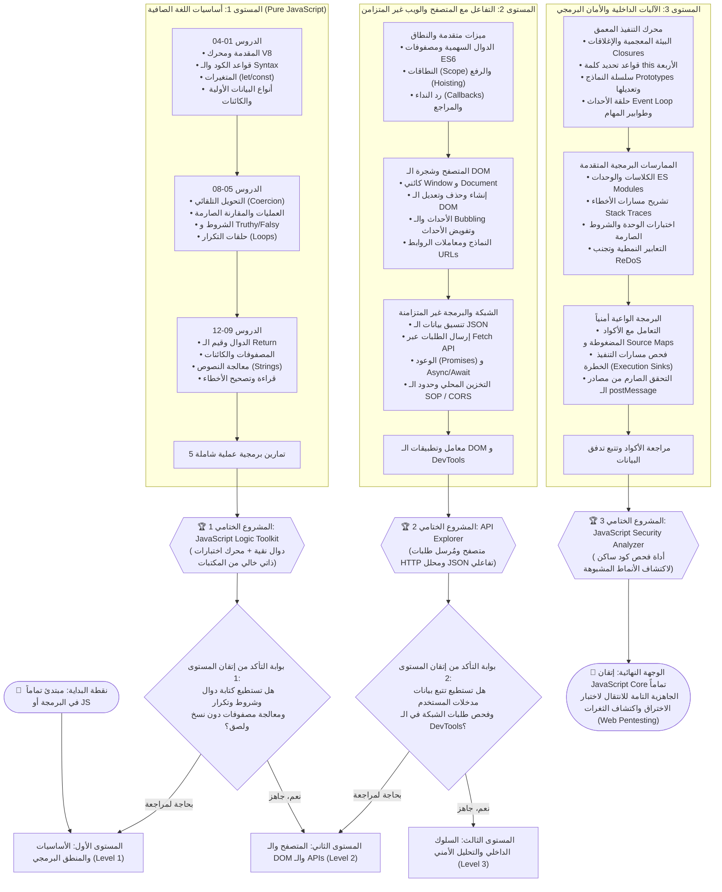

# 🗺️ الدليل الهندسي الشامل لمسار جافا سكريبت | JavaScript Core Guide

> 🌐 **اللغة:** **العربية 🇸🇦** | [English Version (README.md)](./README.md)

> **بِسْمِ اللَّهِ الرَّحْمَٰنِ الرَّحِيمِ**
>
> *"وَقُل رَّبِّ زِدْنِي عِلْمًا"*

مرحباً بك في **الدليل البرمجي الشامل لمسار جافا سكريبت**!  
هذا المستودع صُمم ليكون مرجعاً تعليمياً وهندسياً متدرجاً ينقلك من كتابة أول سطر كود حتى احتراف السلوك الداخلي لمحركات التشغيل، التزامن، والتحليل الأمني للأكواد البرمجية.

---

## 🧭 خريطة الطريق (Roadmap) - من أين تبدأ وإلى أين تصل؟

المسار مقسم إلى ثلاث محطات رئيسية متتابعة، توضح لك بدقة أين أنت وما هي خطوتك التالية:



---

## 📂 هيكلية المستودع الحالية

جميع الأقسام تحتوي على ملفات ثنائية اللغة (`/ar` للشرح العربي و `/en` للمحتوى الإنجليزي):

```plaintext
Programming Languages/
├── README.md                                    # الواجهة الرئيسية للمستودع بالإنجليزية
├── README.ar.md                                 # هذا الملف (الواجهة العربية الكاملة)
└── 01-JavaScript-Core/                          # مسار جافا سكريبت الأساسي الكامل
    ├── README.md                                # خطة وفهرس مسار JS الأساسي (English)
    ├── README.ar.md                             # دليل وفهرس جافا سكريبت الأساسي (العربية)
    │
    ├── Level-1-Basic/                           # 🟢 المستوى 1: الأساسيات والمنطق البرمجي
    │   ├── README.md (English)
    │   ├── README.ar.md (العربية)
    │   ├── Lessons/                             # الدروس الـ 12 المشروحة خطوة بخطوة
    │   │   ├── ar/ (12 ملف شرح كامل)
    │   │   └── en/ (12 full lesson files)
    │   ├── Exercises/                           # بنك التمارين الخمسة
    │   │   ├── ar/README.md
    │   │   └── en/README.md
    │   └── Final-Project/                       # مشروع JavaScript Logic Toolkit
    │       ├── ar/README.md
    │       └── en/README.md
    │
    ├── Level-2-Foundation/                      # 🟡 المستوى 2: المتصفح والـ DOM والشبكة
    │   ├── README.md (English)
    │   ├── README.ar.md (العربية)
    │   ├── Lessons/ (ar/ & en/)                 # فهرس الدروس الـ 15
    │   ├── Practical-Applications/ (ar/ & en/)  # معامل وتطبيقات الـ DOM
    │   └── Final-Project/ (ar/ & en/)           # مشروع API Explorer
    │
    └── Level-3-Advanced/                        # 🔴 المستوى 3: العمق الداخلي والتحليل الأمني
        ├── README.md (English)
        ├── README.ar.md (العربية)
        ├── Lessons/ (ar/ & en/)                 # فهرس الدروس الـ 13 المتقدمة
        ├── Testing-and-Review/ (ar/ & en/)      # معامل مراجعة الأكواد
        └── Final-Project/ (ar/ & en/)           # مشروع JavaScript Security Analyzer
```

---

## 🚀 كيف تستخدم هذا المستودع؟

1. **الخطوة الأولى:** إذا كنت في بداية رحلتك، توجه فوراً إلى [`الدرس الأول: مقدمة عن جافا سكريبت وبيئة العمل`](./01-JavaScript-Core/Level-1-Basic/Lessons/ar/01-introduction.md).
2. **الخطوة الثانية:** تدرج في الدروس من `01` إلى `12`، وطبق كل مثال برمجياً في الـ Console لديك.
3. **الخطوة الثالثة:** انتقل إلى [`تمارين المستوى الأول`](./01-JavaScript-Core/Level-1-Basic/Exercises/ar/README.md) وحل التمارين الـ 5 بمفردك دون نسخ كود جاهز.
4. **الخطوة الرابعة:** افتح [`مشروع JavaScript Logic Toolkit`](./01-JavaScript-Core/Level-1-Basic/Final-Project/ar/README.md) وتأكد من فهمك لبناء الدوال النقية واختبارات الـ assertions.
5. **الخطوة الخامسة:** بعد اجتياز بوابة المستوى الأول، انتقل إلى [`المستوى الثاني: التأسيس والتفاعل مع المتصفح`](./01-JavaScript-Core/Level-2-Foundation/README.ar.md) لإتقان الـ DOM وأحداث الويب والـ APIs.

---

<p align="center">
  صُنع بـ ❤️ لخدمة وتطوير مجتمع المبرمجين العربي • متوفر باللغتين العربية والإنجليزية
</p>
