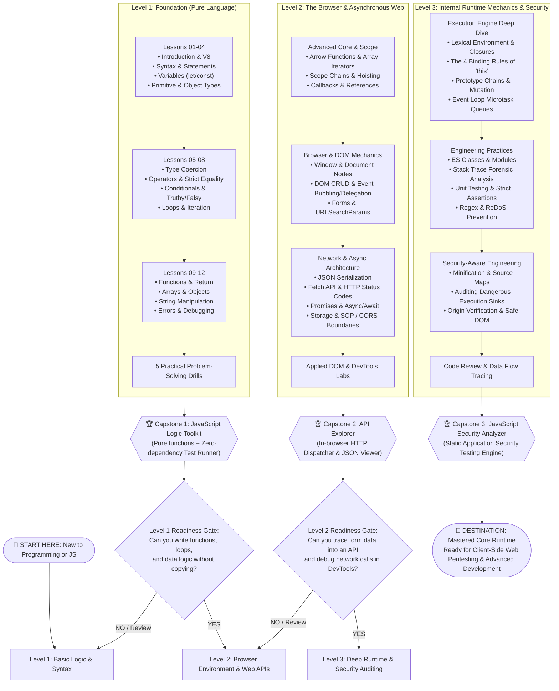

# 🗺️ JavaScript Core Engineering Guide

> 🌐 **Language:** **English** | [🇸🇦 تصفح باللغة العربية (README.ar.md)](./README.ar.md)

Welcome to the **JavaScript Core Engineering Guide**!  
This repository is an open-source, dual-language pedagogical curriculum designed to take you from writing your first line of code to mastering browser runtime execution, asynchronous concurrency, and security-aware code analysis.

---

## 🧭 The Learning Roadmap (Where Are You & Where Are You Going?)

This curriculum is structured as a linear, milestone-driven progression. Follow the roadmap below:



---

## 📂 Active Repository Structure

Every directory contains dedicated English (`/en`) and Arabic (`/ar`) documentation and code files:

```plaintext
Programming Languages/
├── README.md                                    # Root Navigation & Master Roadmap (English)
├── README.ar.md                                 # الدليل وخريطة المسار بالعربية
└── 01-JavaScript-Core/                          # Complete JavaScript Core Track
    ├── README.md                                # JS Core Roadmap & Syllabus (English)
    ├── README.ar.md                             # دليل جافا سكريبت بالعربية
    │
    ├── Level-1-Basic/                           # 🟢 LEVEL 1: Basic Logic & Syntax
    │   ├── README.md                            # English Overview & Checklist
    │   ├── README.ar.md                         # نظرة عامة بالعربية
    │   ├── Lessons/                             # 12 Complete Step-by-Step Lessons
    │   │   ├── en/ (01 to 12 .md files)
    │   │   └── ar/ (01 to 12 .md files)
    │   ├── Exercises/                           # 5 Problem-Solving Drills
    │   │   ├── en/README.md
    │   │   └── ar/README.md
    │   └── Final-Project/                       # Project: JavaScript Logic Toolkit
    │       ├── en/README.md
    │       └── ar/README.md
    │
    ├── Level-2-Foundation/                      # 🟡 LEVEL 2: Browser & Web APIs
    │   ├── README.md
    │   ├── README.ar.md
    │   ├── Lessons/ (en/ & ar/)                 # 15 Lessons Directory & Syllabus
    │   ├── Practical-Applications/ (en/ & ar/)  # Applied DOM & DevTools Labs
    │   └── Final-Project/ (en/ & ar/)           # Project: API Explorer
    │
    └── Level-3-Advanced/                        # 🔴 LEVEL 3: Internals & Security Auditing
        ├── README.md
        ├── README.ar.md
        ├── Lessons/ (en/ & ar/)                 # 13 In-Depth Lessons Syllabus
        ├── Testing-and-Review/ (en/ & ar/)      # Code Review & Audit Drills
        └── Final-Project/ (en/ & ar/)           # Project: JavaScript Security Analyzer
```

---

## 🚀 How to Navigate This Repository

1. **Step 1:** If you are starting fresh, jump directly into [`Level 1 — Lesson 01: Introduction`](./01-JavaScript-Core/Level-1-Basic/Lessons/en/01-introduction.md).
2. **Step 2:** Work through Lessons `01` to `12`, testing snippets locally in your browser console or Node.js.
3. **Step 3:** Complete the [`Level 1 Exercises`](./01-JavaScript-Core/Level-1-Basic/Exercises/en/README.md).
4. **Step 4:** Build the [`JavaScript Logic Toolkit`](./01-JavaScript-Core/Level-1-Basic/Final-Project/en/README.md) and ensure all assertion tests pass (`PASS`).
5. **Step 5:** Proceed to [`Level 2 — Foundation`](./01-JavaScript-Core/Level-2-Foundation/README.md) to conquer DOM, events, and asynchronous web communication.

---

<p align="center">
  Crafted with ❤️ for developers worldwide • Bilingual English / العربية
</p>
