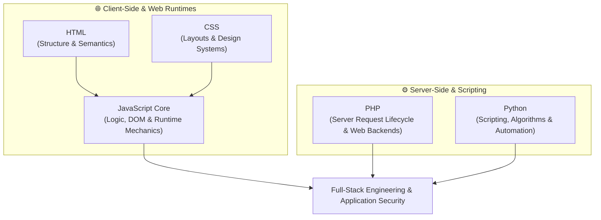

# 🚀 Programming Languages & Web Technologies Guide

> 🌐 **Language:** **English** | [🇸🇦 تصفح باللغة العربية (README.ar.md)](./README.ar.md)

Welcome to the **Programming Languages & Web Technologies Guide**!  
This repository is an open-source, dual-language engineering reference designed to provide clear, structured, and deep educational roadmaps across core programming languages and web runtime architectures.

---

## 🗺️ Master Curriculum Roadmap

The technologies in this repository represent the foundational pillars of modern software engineering, divided into client-side web foundations and server-side scripting:

---

## 📚 Curriculum Tracks Overview

Each technology is structured into modular, step-by-step learning units accompanied by practical code drills, diagnostic debugging techniques, and capstone projects.

### 🌐 1. Frontend & Client-Side Runtimes

* **[JavaScript Core (`/01-JavaScript-Core`)](./01-JavaScript-Core/README.md)**  
  A complete 3-tier master track taking you from fundamental syntax and pure algorithmic logic, through browser DOM and asynchronous APIs, up to internal V8 execution mechanics (Event Loop, Prototype Chains, Closures) and static security code auditing.
  - 👉 **[Explore JavaScript Core Track](./01-JavaScript-Core/README.md)**

* **HTML**  
  Document structure, semantic web standards, DOM node hierarchies, form architectures, and Web Accessibility (a11y).

* **CSS**  
  Visual layout engines (Flexbox, CSS Grid), responsive design patterns, CSS variables, and rendering performance.

---

### ⚙️ 2. Server-Side, Systems & Scripting

* **PHP**  
  Server-side programming, HTTP request/response lifecycles, session handling, database interactions, and backend web architectures.

* **Python**  
  Data structures, algorithms, object-oriented design, system scripting, file I/O, and programmatic automation.

---

## 📁 Repository Standards & Architecture

Every language track in this repository adheres to strict pedagogical principles:

1. **Dual-Language First (`/en` and `/ar`):** Every lesson, drill, and project documentation is provided in both **English** and **Arabic**.
2. **Pure Markdown (`.md`):** Optimized for seamless browsing on GitHub, desktop editors, and mobile devices.
3. **No Fluff & No Black Boxes:** Concepts are explained from first principles with runnable, dependency-free vanilla code.
4. **Milestone Capstones:** Every tier concludes with a self-contained capstone application and an automated, zero-dependency assertion test runner.

---

## 🧭 How to Begin

The repository is built for self-paced, progressive learning:

1. **Web Foundations & Interactive Logic:**  
   Begin immediately with the comprehensive JavaScript track:  
   👉 **[Start with JavaScript Level 1: Basic Logic & Syntax](./01-JavaScript-Core/Level-1-Basic/README.md)**
2. **Track Progression:** Complete the lessons, solve the dedicated challenge exercises, and run the capstone assertion suites.
3. **Language Toggle:** You can switch between English and Arabic at any point using the top-level language switcher on every file.

---

  Built with ❤️ for developers and security engineers worldwide • Bilingual English / العربية

